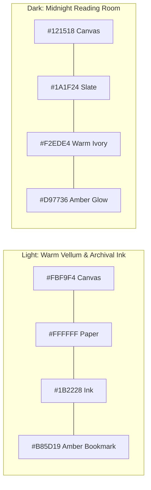

# Pandora Online Book Store — Design System & Theme Specification

**Document:** `design.md`  
**Project:** Pandora Online Book Store (Academic Web Technology Project)  
**Version:** 2.0  
**Status:** Approved Architectural Direction  

---

## 1. Executive Summary & Design Philosophy

Most modern AI-generated web interfaces default to predictable clichés: neon purple/indigo gradients, heavy glassmorphism blurs, floating blob decorations, and generic SaaS "pill-button" card grids. 

An **online bookstore** represents a distinct cultural and literary space. Physical and digital literary institutions (such as *The Strand, Penguin Random House, Daunt Books, The Folio Society, and Kinokuniya*) succeed because they embrace **tactile paper tones, crisp ink typography, calm natural contrasts, and flat architectural clarity**. The books themselves provide the color and visual richness; the platform provides the serene, high-contrast gallery in which to discover them.

### Core Design Principles
1. **Ink & Paper First:** Typography should feel printed on fine paper. Headings have editorial presence; body text maintains high legibility.
2. **Zero "AI Gimmicks":** No neon glow, no purple/cyan mesh gradients, no decorative emoji shelves (`📚 ☕`), and no heavy 3D glass cards.
3. **Flat, Crisp Surfaces:** Solid colors with subtle hairline borders (`1px`) replace blurry gradients.
4. **Book Jacket as the Hero:** The UI provides an understated frame so book covers immediately catch the reader's eye.
5. **Micro-Radii (3px – 6px):** Rectangular stability replaces overly bubbly "pill" borders, imparting a professional, curated feel.

---

## 2. Proposed Theme Options (Light & Dark)

We have engineered two complete, non-generic themes tailored specifically for a high-end online bookstore.

---

### Option A (Recommended): "The Oxford Library" (Heritage Literary)

*Inspired by archival reading rooms, fine bookbinding, vellum endpapers, and classic Penguin clothbound editions.*



#### Color Token Mapping

| Token Name | Light Value | Dark Value | Purpose / Role |
| :--- | :--- | :--- | :--- |
| `--color-page` | `#FBF9F4` (Warm Vellum) | `#121518` (Midnight Reading Room) | Full page background canvas |
| `--color-surface` | `#FFFFFF` (Pure Paper) | `#1A1F24` (Elevated Slate) | Book cards, checkout summary, tables |
| `--color-surface-subdued`| `#F3EFE7` (Pressed Linen) | `#15181C` (Deep Charcoal) | Subdued banners, input backgrounds |
| `--color-text-heading` | `#1B2228` (Carbon Ink) | `#F2EDE4` (Warm Ivory) | Editorial headlines (H1-H6) |
| `--color-text-body` | `#2D3338` (Deep Slate Ink) | `#D2D7DD` (Soft Silver) | General reading copy, descriptions |
| `--color-text-muted` | `#6B737B` (Pencil Gray) | `#88929A` (Muted Slate) | Authors, ISBNs, metadata, breadcrumbs |
| `--color-primary-accent` | `#B85D19` (Heritage Amber) | `#D97736` (Illuminated Amber) | Primary buttons, active tabs, highlights |
| `--color-primary-hover` | `#9B4C10` (Dark Leather) | `#E28A4E` (Bright Amber) | Hover states for primary actions |
| `--color-secondary-accent`| `#3D5A50` (Spruce Green) | `#608679` (Botanical Sage) | In-stock badges, secondary links |
| `--color-border` | `#E3DCD1` (Antique Rule) | `#262D35` (Muted Rule) | Structural dividers, card borders |
| `--color-border-subtle` | `#ECE6DC` | `#1E2329` | Table row dividers, inner borders |

---

### Option B: "The Modern Bibliophile" (Nordic Atelier / Kinokuniya)

*Inspired by minimalist Japanese art bookshops and Scandinavian publishing houses. Quiet, architectural, and highly structured.*

#### Color Token Mapping

| Token Name | Light Value | Dark Value | Purpose / Role |
| :--- | :--- | :--- | :--- |
| `--color-page` | `#F5F5F3` (Pale Bone) | `#101211` (Matte Carbon) | Clean architectural canvas |
| `--color-surface` | `#FFFFFF` (Stark White) | `#181B19` (Deep Charcoal Pine) | Book cards, panels, modals |
| `--color-surface-subdued`| `#ECECE8` (Stone White) | `#141615` (Subdued Panel) | Search bars, filter backgrounds |
| `--color-text-heading` | `#181B1A` (Pure Ink) | `#EBEAE5` (Unbleached Linen) | Crisp modern serif headers |
| `--color-text-body` | `#2E3331` (Off-Black) | `#CBCAC5` (Soft Ash) | Body copy |
| `--color-text-muted` | `#707673` (Stone Gray) | `#848B87` (Muted Moss) | Secondary metadata |
| `--color-primary-accent` | `#B34A36` (Terracotta Brick) | `#CC5E49` (Warm Clay) | Primary actions & callouts |
| `--color-primary-hover` | `#963B29` | `#D97360` | Action hover |
| `--color-secondary-accent`| `#2A5243` (Deep Pine) | `#4E7B6A` (Nordic Pine) | Stock indicators, tags |
| `--color-border` | `#DDDCD7` (Mist Border) | `#242927` (Charcoal Border) | 1px clean hairline frames |
| `--color-border-subtle` | `#E9E8E4` | `#1C201E` | Inner dividers |

---

## 3. Typography System

Book typography demands high contrast and deliberate proportional rhythm.

### Typefaces
- **Headings (Display):** `'Playfair Display', Georgia, 'Times New Roman', serif`
  - High editorial character, distinctive serif terminals.
- **Body & Functional UI:** `'Inter', -apple-system, BlinkMacSystemFont, 'Segoe UI', sans-serif`
  - Tall x-height, neutral legibility for prices, numbers, forms, and admin data.
- **Code & Identifiers (ISBNs, Order IDs):** `'JetBrains Mono', 'Courier New', monospace`

### Scale & Hierarchy
```text
Display / Hero : 2.5rem (40px) | Weight: 700 | Line-height: 1.15
Page Title H1  : 2.0rem (32px) | Weight: 700 | Line-height: 1.25
Section H2     : 1.5rem (24px) | Weight: 600 | Line-height: 1.3
Card Title H3  : 1.125rem (18px) | Weight: 600 | Line-height: 1.35
Body Regular   : 0.95rem (15px) | Weight: 400 | Line-height: 1.6
Caption / Meta : 0.8125rem (13px) | Weight: 500 | Letter-spacing: 0.02em
Eyebrow / Tag  : 0.75rem (12px) | Weight: 700 | Letter-spacing: 0.08em (Uppercase)
```

---

## 4. Layout & Component Architecture (Anti-AI Patterns)

### 4.1 Navigation Bar (`Header.jsx`)
- **Visual Style:** Flat solid surface (`#FBF9F4` in Light or `#121518` in Dark) with a single crisp bottom border `1px solid var(--color-border)`.
- **Branding:** Elegant serif wordmark: **PANDORA** (tracked at `0.06em`).
- **Cart Badge:** Flat solid square or subtle circle tag (no neon pulse).

### 4.2 Editorial Hero (`HomePage.jsx`)
- **Problem with Current Hero:** Multi-color linear gradient with pastel orange and emoji shelf (`📚 📖 ☕`).
- **New Pattern:**
  - Flat, calm background (`var(--color-surface-subdued)`).
  - Editorial left column: Small uppercase eyebrow (`"SPRING 2026 RELEASES"`), bold headline (`"Curated Fiction, Timeless Philosophy, Rare Finds"`), short 2-line subtitle, and sharp primary CTA.
  - Right column: Clean featured book showcase (real cover art framed by a 1px border and soft natural shadow, rather than cartoon emojis).

### 4.3 Book Cards (`BookCard.jsx`)
- **Aspect Ratio:** Standard book jacket ratio `1 : 1.45`.
- **Card Surface:** Pure paper `#FFFFFF` (Light) or `#1A1F24` (Dark).
- **Border:** `1px solid var(--color-border)` (gives structural definition without blurry card shadows).
- **Hover Behavior:** Micro-elevation (`transform: translateY(-2px); box-shadow: 0 4px 12px rgba(0,0,0,0.06)`). No spinning or color flashing.

### 4.4 Checkout & Shopping Cart (`CartPage.jsx`, `CheckoutPage.jsx`)
- Clean two-column split layout.
- Order summary formatted like a traditional printed invoice: clean dashed lines, bold numeric alignment, and clear delivery timeline.

### 4.5 Admin Desk (`AdminLayout.jsx`, `BooksPage.jsx`, `OrdersPage.jsx`)
- Monochromatic, data-dense editorial layout.
- Solid dark sidebar `#121518` or clean light sidebar `#F2EDE4`.
- Tables styled with hairline dividers and flat status pills:
  - **Pending:** `#687178` (Subtle Slate)
  - **Confirmed:** `#3D5A50` (Spruce)
  - **Shipped:** `#2A5A72` (Muted Steel Blue)
  - **Delivered:** `#2E7D32` (Forest Green)
  - **Cancelled:** `#B33928` (Muted Brick Red)

---

## 5. Implementation Guide: CSS Token File (`tokens.css`)

Here is the drop-in CSS specification for **Option A ("The Oxford Library")**:

```css
:root {
  /* ==========================================================================
     LIGHT MODE: The Oxford Library (Warm Vellum & Carbon Ink)
     ========================================================================== */
  --color-page: #FBF9F4;
  --color-surface: #FFFFFF;
  --color-surface-subdued: #F3EFE7;
  --color-surface-hover: #F6F2EA;
  
  --color-text-heading: #1B2228;
  --color-text: #2D3338;
  --color-muted: #6B737B;
  
  --color-primary-accent: #B85D19;
  --color-primary-hover: #9B4C10;
  --color-secondary-accent: #3D5A50;
  
  --color-border: #E3DCD1;
  --color-border-subtle: #ECE6DC;

  /* Semantic Structural Tokens */
  --header-bg: #FBF9F4;
  --header-text: #1B2228;
  --footer-bg: #1B2228;
  --footer-text: #F2EDE4;
  --sidebar-bg: #1B2228;
  --sidebar-text: #F2EDE4;
  --input-bg: #FFFFFF;
  --input-text: #1B2228;
  --input-border: #DCD4C7;
  --card-subdued-bg: #F3EFE7;
  --table-hover-bg: rgba(27, 34, 40, 0.03);
  --modal-backdrop-bg: rgba(18, 21, 24, 0.6);

  /* Status Colors */
  --color-status-pending: #6B737B;
  --color-status-confirmed: #3D5A50;
  --color-status-shipped: #2B576C;
  --color-status-delivered: #2E7D32;
  --color-status-cancelled: #B83B26;

  /* Typography */
  --font-body: 'Inter', -apple-system, BlinkMacSystemFont, 'Segoe UI', Roboto, sans-serif;
  --font-display: 'Playfair Display', Georgia, 'Times New Roman', serif;
  --font-mono: 'JetBrains Mono', 'Courier New', monospace;

  /* Spacing Scale */
  --space-1: 4px;
  --space-2: 8px;
  --space-3: 12px;
  --space-4: 16px;
  --space-6: 24px;
  --space-8: 32px;
  --space-12: 48px;
  --space-16: 64px;

  /* Shape and Depth (Crisp Micro-Radii, No Excessive Blur) */
  --radius-small: 4px;
  --radius-medium: 6px;
  --radius-large: 8px;
  --radius-full: 9999px;
  --shadow-card: 0 1px 3px rgba(27, 34, 40, 0.05), 0 1px 2px rgba(27, 34, 40, 0.03);
  --shadow-hover: 0 4px 12px rgba(27, 34, 40, 0.08);

  /* Layout */
  --container-max-width: 1200px;
}

[data-theme="dark"] {
  /* ==========================================================================
     DARK MODE: Midnight Reading Room (Matte Slate & Amber Bookmark)
     ========================================================================== */
  --color-page: #121518;
  --color-surface: #1A1F24;
  --color-surface-subdued: #15181C;
  --color-surface-hover: #21282F;
  
  --color-text-heading: #F2EDE4;
  --color-text: #D2D7DD;
  --color-muted: #88929A;
  
  --color-primary-accent: #D97736;
  --color-primary-hover: #E28A4E;
  --color-secondary-accent: #608679;
  
  --color-border: #262D35;
  --color-border-subtle: #1E2329;

  /* Semantic Structural Tokens */
  --header-bg: #121518;
  --header-text: #F2EDE4;
  --footer-bg: #0D0F11;
  --footer-text: #F2EDE4;
  --sidebar-bg: #0E1013;
  --sidebar-text: #F2EDE4;
  --input-bg: #161A1E;
  --input-text: #F2EDE4;
  --input-border: #2B343D;
  --card-subdued-bg: #15181C;
  --table-hover-bg: rgba(242, 237, 228, 0.04);
  --modal-backdrop-bg: rgba(5, 7, 8, 0.8);

  /* Status Colors Dark Mode */
  --color-status-pending: #88929A;
  --color-status-confirmed: #608679;
  --color-status-shipped: #528299;
  --color-status-delivered: #4CAF50;
  --color-status-cancelled: #E0533C;

  /* Atmospheric Shadows */
  --shadow-card: 0 1px 3px rgba(0, 0, 0, 0.3);
  --shadow-hover: 0 6px 18px rgba(0, 0, 0, 0.45);
}
```

---

## 6. Migration & Refactoring Roadmap

To transition the frontend to this design:
1. **Apply `tokens.css`**: Replace the root variables with the new token values.
2. **Remove Hardcoded CSS**:
   - Replace `#333`, `#666`, `#f5f5f5` in `CartPage.css`, `CheckoutPage.css`, and `OrderHistoryPage.css` with `var(--color-surface)` and `var(--color-text)`.
   - Update `AdminLayout.css` to respect `[data-theme="dark"]` instead of its hardcoded class rules.
3. **Strip Clutter in `HomePage.css`**:
   - Remove radial gradients and emoji shelves (`📚 📖 ☕`).
   - Replace with flat solid backgrounds, clean typography, and real book covers.
